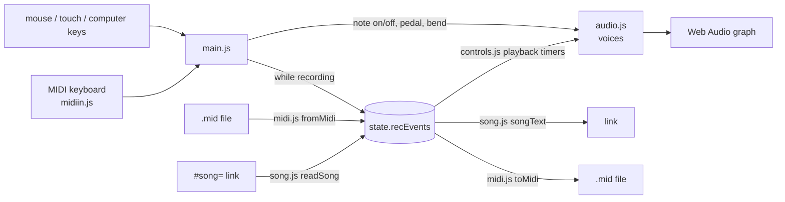

# How Meow Piano is built

A static site: HTML, CSS and plain ES modules, no framework, no bundler, no runtime dependencies. Everything
runs in the browser; nothing is uploaded and there is no server beyond GitHub Pages. About 2,000 lines of
app code (`js/`) and 1,100 of tests.

## Runtime

| Piece | What it uses |
|---|---|
| Sound | **Web Audio API**: `AudioBufferSourceNode`, `GainNode`, `AnalyserNode` (the waveform) |
| MIDI keyboard | **Web MIDI API** (`navigator.requestMIDIAccess`). Chrome, Edge, Firefox; not Safari |
| MIDI files | Hand-written reader and writer for Standard MIDI Files (`js/midi.js`), no library |
| Song links | `CompressionStream('deflate-raw')` + base64url, in the URL fragment |
| Fonts | Press Start 2P from Google Fonts |
| Libraries | None at runtime |

Dev only: Vitest (unit tests), Playwright + axe-core (browser and accessibility tests), sharp (writes the
help page's animated WebP clips). Offline, once: librosa (Python) to make the 25 note samples.

## Files

```
index.html        the piano; help.html the guide (clips in help/)
css/style.css     all styling
js/
  main.js         wiring: computer keys, MIDI keyboard hooks, what's lit, startup
  state.js        one shared mutable state object (settings, voices, the take)
  notes.js        the 25 keys (C4–C6), their base frequencies and computer keys
  keyboard.js     builds the on-screen keys; mouse and touch (glide across keys)
  audio.js        the sound engine: voices, granular sustain, pedal, bends
  controls.js     panels and transport: octave, loop/grain/tuning, pitch wheel, REC/PLAY/seek/OPEN/SAVE/SHARE
  song.js         the song-link format; playback helpers (spring-back, state at a time, cutting to fit)
  midi.js         .mid read/write; turning a file's instruments into piano events
  midiin.js       live MIDI keyboard input
  dsp.js          loop-window search (tested; not used at runtime)
sounds/           meow.ogg (source) and notes/*.ogg (one pre-pitched sample per key)
songs/            canon-in-d.mid (test and demo; made by scripts/make-canon.js)
scripts/          process_samples.py (makes sounds/notes), make-canon.js
tools/            help-clips.js (records help/*.webp)
tests/, e2e/      unit tests (Vitest) and browser tests (Playwright, desktop + phone, axe)
```

`song.js`, `midi.js`, `notes.js` and `dsp.js` are pure (no DOM, no audio) and carry most of the unit tests.

## How it fits together



Everything that plays, whether recorded, opened from a file or opened from a link, becomes the same list of
events: `on` (note, frequency, loop points, time), `off`, `sustain_on/off`, `pitch` (wheel position) and
`wheel_release`. Playback, the seek bar, links and MIDI files all read and write that one list.

## The sound

There is one recording of a cat (Silas). `scripts/process_samples.py` pitch-shifts it offline into 25 samples
of equal length (phase vocoder, so higher notes don't get shorter). First it high-passes the recording at 200 Hz:
the original has low rumble (8–80 Hz) that was heard as a faint beat, and the meow itself stays above ~600 Hz. Notes outside those two octaves, octave
shifts, the pitch wheel and tuning are all `playbackRate` on top of the nearest sample.

A held note can't just loop the sample (it would sound like "meowowow"), so each voice is two layers:

1. **Attack**: the sample plays from the start and fades out at the loop-in point.
2. **Sustain**: a granular cloud. Every few tens of milliseconds a short grain (20–200 ms, the GRAIN slider)
   starts at a random spot between loop-in and loop-out, with a triangular envelope; grains overlap by the
   SCATTER amount. A scheduler fills 300 ms ahead on a 100 ms `setTimeout` so timing doesn't depend on the
   main thread.

Key up (unless the pedal holds it) fades the cloud and plays the sample's tail from loop-out: the "w" at the end
of the meow. A tap released before loop-in just plays the whole meow once. Pedal, key and voice rules follow a
real piano: the pedal catches notes already down, and pedal-up releases only notes whose keys are up.

## Song links

A take is packed into the URL fragment (`#song=…`, never sent to a server) like a player-piano roll:

- Header: format version, loop points, grain settings, tuning, the song's name.
- One record per note, pedal change, wheel point or loop change, in time order. Note starts in 5 ms ticks,
  held lengths in 10 ms steps, the key as one byte (note + octave).
- Wheel drags are simplified with Ramer–Douglas–Peucker to within 4 cents; a wheel release is one record and
  playback rebuilds the spring-back.
- Columns (ops, times, keys, lengths, bends, loops) are stored apart as varints so deflate finds the patterns.

Links stop at 8,000 characters (what chat apps reliably pass); about five minutes of busy playing. A longer
take's link keeps its last part, cut cleanly: `song.js slice()` restarts the song as it stood at the cut
(pedal, wheel, notes still sounding). The same function lets the seek bar start playback mid-song. Older
link versions still open (`unpack` reads versions 1–3).

## MIDI

- **Reading** (`fromMidi`): parses format 0 and 1 files: running status, tempo maps (and SMPTE timing),
  velocity-0 note-offs, sysex skipped. Each track-and-channel with notes is an instrument; channel 10 is
  drums, off by default. Notes outside C2–C8 fold by octaves. Since voices are keyed by key name, two notes of
  the same pitch class in different octaves get different keys (`keyFor`). Velocity is ignored. The song's
  name comes from a track without notes (the conductor track) if there is one.
- **Writing** (`toMidi`): one track, 1 tick = 1 ms, notes, CC64 pedal, pitch bend at ±2 semitones. Settings
  and name ride along as text events starting `meowpiano`, so a saved file reopens with the same sound.
- **Live input** (`midiin.js`): note on/off, CC64, pitch bend into the same paths as the computer keys.
  On/off is remembered in `localStorage`.

## Testing and deploy

- `npm test`: Vitest on the pure modules: link round-trips (including a generated five-minute "expressive"
  piece that must fit in a link), MIDI parsing of a hand-built multi-track file, the Canon file, DSP.
- `npm run test:e2e`: Playwright at desktop and phone size against the real page, with a stand-in MIDI
  device, generated MIDI files and axe accessibility checks on both pages.
- Pushing to `main` runs both in GitHub Actions (the shared workflow in
  [csciuto/app-template](https://github.com/csciuto/app-template)); only if they pass is the site stamped with
  a version and published to GitHub Pages.

## Known limits

- One loudness for every note (no velocity).
- The wheel bends ±2 semitones; MIDI files with wider bend ranges are squeezed into that.
- Laptop keyboards register only a few keys at once (hardware), so big chords need the pedal or a MIDI keyboard.
- Help clips are silent (animated WebP has no audio).
